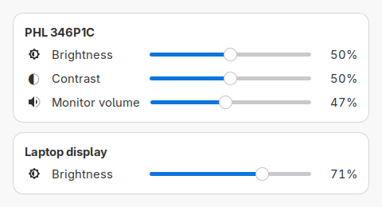

# Monitor Control (`monctl`)

Control external monitor brightness, contrast, and speaker volume using DDC/CI,
and adjust your laptop display brightness. Use the desktop window or the
command-line interface (CLI) on Linux. Monitor volume is **not** the Linux system
volume.



## Install and set up

Download the prebuilt package for your system from
[GitHub Releases](https://github.com/giesan/monctl/releases), then run:

```sh
# Debian / Ubuntu: from the directory containing the downloaded .deb
sudo apt install ./monctl_*_linux_amd64.deb

# Arch / Manjaro: from the directory containing the downloaded package
sudo pacman -U ./monctl_*_linux_amd64.pkg.tar.zst
```

The packages install the graphical window, CLI, application-menu launcher and
icons, and depend on `ddcutil`, GTK 3, and systemd. The current packages are
for x86-64 Linux. After installation, run this as your normal user:

```sh
monctl setup
```

Setup checks for the `i2c-dev` kernel module, offers to load it and enable it
at boot if necessary (requesting sudo only then), and checks for DDC/CI monitors.
It does **not** change permissions for `/dev/i2c-*`. You can run setup again
later.

For an external monitor, enable DDC/CI in the monitor's own settings menu.
If monitor detection fails because access to `/dev/i2c-*` is denied, follow the
[ddcutil setup guide](https://www.ddcutil.com/config_steps/) to configure
persistent access. If no `/dev/i2c-*` devices exist, try `sudo modprobe i2c-dev`
and run `monctl setup` again. Controls not supported by your monitor are hidden.

## Desktop window

Launch **Monitor Control** from the application menu or run `monctl` without
arguments. Use the sliders to adjust external monitor brightness, contrast, and
speaker volume, or the laptop display's brightness. Changes take effect when
you move a slider. Close the window to exit. The window uses your desktop's
GTK 3 theme on X11 or Wayland.

## Command line

The installed package also provides these commands:

```sh
monctl --version             # Show the installed version
monctl list                  # List external monitors and their bus numbers
monctl get                   # Read external monitor brightness
monctl set 50                # Set external monitor brightness to 50%
monctl contrast get          # Read contrast
monctl contrast set 45       # Set contrast to 45%
monctl volume get            # Read monitor speaker volume
monctl volume set 30         # Set monitor speaker volume to 30%
monctl laptop get            # Read laptop display brightness
monctl laptop set 50         # Set laptop display brightness to 50%
```

If multiple external monitors support a control, use the bus number reported by
`monctl list`: for example, `monctl get 7`, `monctl set 7 50`, or
`monctl contrast set 7 45`. Bus numbers may change after reconnecting monitors
or rebooting. Percentages are whole numbers from 0 to 100; hardware may round
or limit them. Laptop brightness uses the built-in backlight through
systemd-logind rather than DDC/CI. If multiple laptop backlight devices are
found, the command reports the ambiguity instead of selecting one.

To build from source, run tests, or create packages, see [DEVELOPMENT.md](DEVELOPMENT.md).

## Project note

This project was implemented entirely with AI.
